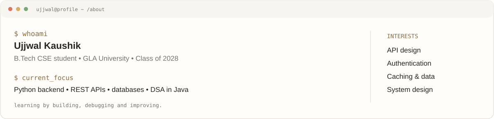
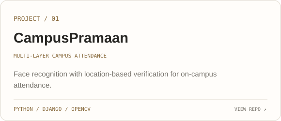
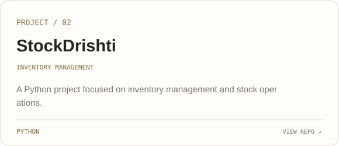
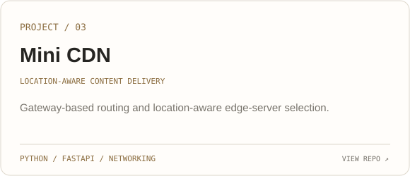
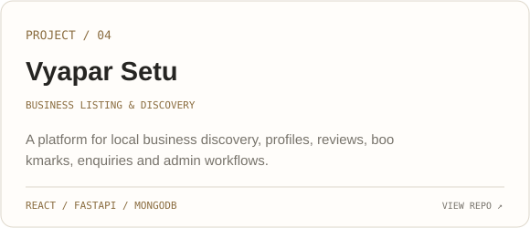
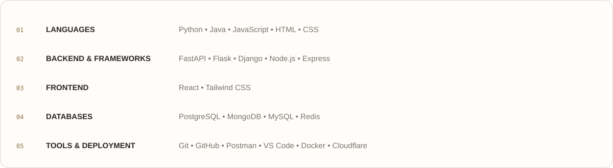
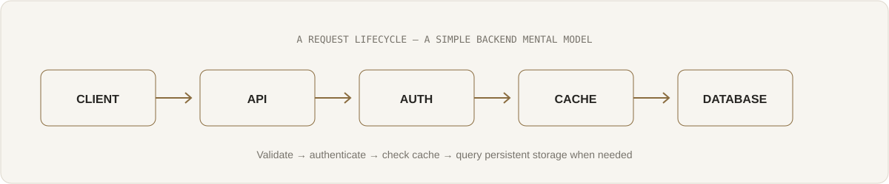

<!-- Original profile design for Ujjwal Kaushik. All artwork in assets/ was created for this repository. -->

<picture><source media="(prefers-color-scheme: dark)" srcset="assets/hero-dark.svg"></picture>

<a href="https://www.linkedin.com/in/ujjwal-kaushik-447763280"><picture><source media="(prefers-color-scheme: dark)" srcset="assets/buttons/linkedin-dark.svg"></picture></a>
<a href="https://leetcode.com/u/ueMXf7R1D6/"><picture><source media="(prefers-color-scheme: dark)" srcset="assets/buttons/leetcode-dark.svg"></picture></a>
<a href="mailto:ujjwalkaus21@gmail.com"><picture><source media="(prefers-color-scheme: dark)" srcset="assets/buttons/email-dark.svg"></picture></a>
<a href="https://github.com/Ujjwal21kaushik"><picture><source media="(prefers-color-scheme: dark)" srcset="assets/buttons/github-dark.svg"></picture></a>

 

<picture><source media="(prefers-color-scheme: dark)" srcset="assets/about-dark.svg"></picture>

<picture><source media="(prefers-color-scheme: dark)" srcset="assets/about-panel-dark.svg"></picture>

 

<picture><source media="(prefers-color-scheme: dark)" srcset="assets/work-dark.svg"></picture>

<a href="https://github.com/Ujjwal21kaushik/CampusPramaan"><picture><source media="(prefers-color-scheme: dark)" srcset="assets/project-campuspramaan-dark.svg"></picture></a>
<a href="https://github.com/Ujjwal21kaushik/StockDrishti"><picture><source media="(prefers-color-scheme: dark)" srcset="assets/project-stockdrishti-dark.svg"></picture></a>
<a href="https://github.com/Ujjwal21kaushik/cdn_project"><picture><source media="(prefers-color-scheme: dark)" srcset="assets/project-cdn-dark.svg"></picture></a>
<a href="https://github.com/Ujjwal21kaushik/Vypaar-Setu"><picture><source media="(prefers-color-scheme: dark)" srcset="assets/project-vyapar-setu-dark.svg"></picture></a>

<picture><source media="(prefers-color-scheme: dark)" srcset="assets/toolbox-dark.svg"></picture>

<picture><source media="(prefers-color-scheme: dark)" srcset="assets/toolbox-panel-dark.svg"></picture>

<picture><source media="(prefers-color-scheme: dark)" srcset="assets/contributions-dark.svg"></picture>

<picture><source media="(prefers-color-scheme: dark)" srcset="assets/problem-solving-dark.svg"></picture>

<picture><source media="(prefers-color-scheme: dark)" srcset="assets/engineering-dark.svg"></picture>

<picture><source media="(prefers-color-scheme: dark)" srcset="assets/backend-flow-dark.svg"></picture>

Every request is validated, authenticated, served from cache when possible, and only then sent to the database.

<picture><source media="(prefers-color-scheme: dark)" srcset="assets/footer-dark.svg"></picture>
