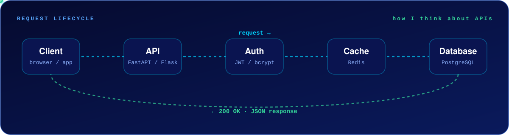

  

  
  
  
  
  

  

---

## 🚀 At a Glance

<table>
<tr>
<td width="50%" valign="top">

### 👨‍💻 Who I am
Computer Science engineering student who enjoys **building backend systems**, **solving DSA problems** and shipping practical projects.

**I learn by building, debugging and improving, one step at a time.**

</td>
<td width="50%" valign="top">

### 🎯 What I'm focused on
| | |
|---|---|
| 🐍 | **Python backend** and REST APIs |
| ☕ | **DSA in Java** |
| 🔐 | Auth, databases, caching, API security |
| ⚛️ | React, Tailwind CSS, JavaScript |

</td>
</tr>
</table>

---

## ⚡ Tech Stack

<table>
<tr>
<td align="center" width="22%"><b>💻 Languages</b></td>
<td>
  
</td>
</tr>
<tr>
<td align="center"><b>🧩 Backend &amp; Frameworks</b></td>
<td>
  
</td>
</tr>
<tr>
<td align="center"><b>🗄️ Databases</b></td>
<td>
  
</td>
</tr>
<tr>
<td align="center"><b>🛠️ Tools &amp; Deploy</b></td>
<td>
  
</td>
</tr>
</table>

---

## 🔄 How I Think About Backends

  

  Every request is validated, authenticated, served from cache when possible, and only then sent to the database.

---

## 🛠️ Projects & Things I Explore

<table>
<tr>
<td width="50%" valign="top">

### 🤖 WhatsApp FAQ Automation
Webhook-based bot that answers customer questions automatically.

`webhooks` · `fuzzy matching` · `AI fallback`

</td>
<td width="50%" valign="top">

### 🏢 Business Listing Platform
Searchable directory with business listings and membership flows.

`search` · `listings` · `memberships`

</td>
</tr>
<tr>
<td width="50%" valign="top">

### 📊 Data Dashboard
Upload spreadsheets and visualise call or lead statuses at a glance.

![Charts]

`file upload` · `data viz` · `status tracking`

</td>
<td width="50%" valign="top">

### 🌐 Mini CDN Concepts
Experimenting with a gateway and location-aware edge servers.

`routing` · `edge` · `caching`

</td>
</tr>
</table>

---

## 🧠 LeetCode & Problem Solving

  

  

  This card is generated by my own GitHub Action straight from LeetCode, so it keeps working without any third-party card service.

---

## 📈 GitHub Dashboard

  
  

  

  

---

## 🤝 Let's Connect

  <i>“Small progress every day adds up to big results.”</i>

  
  
  

  

