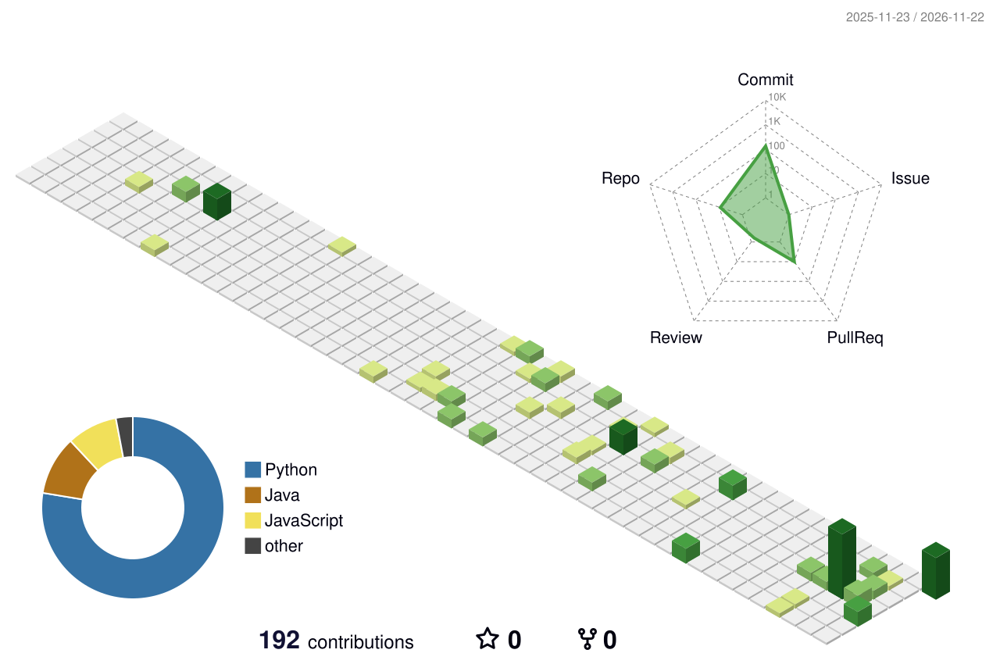

<!--
  Ujjwal Kaushik · GitHub profile README
  Repository name must be exactly: Ujjwal21kaushik
  Layout inspired by Aaradhya Rawat's profile (github.com/Aadi-web-op), used with his permission.
  Images are generated by scripts/ and refreshed by .github/workflows/profile.yml. Edit data in scripts/*.py, not the SVGs.
-->

 
 

<a href="https://www.linkedin.com/in/ujjwal-kaushik-447763280"><picture><source media="(prefers-color-scheme: dark)" srcset="https://raw.githubusercontent.com/Ujjwal21kaushik/Ujjwal21kaushik/main/assets/buttons/linkedin-dark.svg"></picture></a>
<a href="https://leetcode.com/u/ueMXf7R1D6/"><picture><source media="(prefers-color-scheme: dark)" srcset="https://raw.githubusercontent.com/Ujjwal21kaushik/Ujjwal21kaushik/main/assets/buttons/leetcode-dark.svg"></picture></a>
<a href="https://github.com/Ujjwal21kaushik"><picture><source media="(prefers-color-scheme: dark)" srcset="https://raw.githubusercontent.com/Ujjwal21kaushik/Ujjwal21kaushik/main/assets/buttons/github-dark.svg"></picture></a>
<a href="mailto:ujjwalkaus21@gmail.com"><picture><source media="(prefers-color-scheme: dark)" srcset="https://raw.githubusercontent.com/Ujjwal21kaushik/Ujjwal21kaushik/main/assets/buttons/email-dark.svg"></picture></a>

<picture><source media="(prefers-color-scheme: dark)" srcset="https://raw.githubusercontent.com/Ujjwal21kaushik/Ujjwal21kaushik/main/assets/headers/about-dark.svg"></picture>

 

<picture><source media="(prefers-color-scheme: dark)" srcset="https://raw.githubusercontent.com/Ujjwal21kaushik/Ujjwal21kaushik/main/assets/live/about-dark.svg"></picture>

 

<picture><source media="(prefers-color-scheme: dark)" srcset="https://raw.githubusercontent.com/Ujjwal21kaushik/Ujjwal21kaushik/main/assets/headers/work-dark.svg"></picture>

 

<a href="https://github.com/Ujjwal21kaushik/Vypaar-Setu"><picture><source media="(prefers-color-scheme: dark)" srcset="https://raw.githubusercontent.com/Ujjwal21kaushik/Ujjwal21kaushik/main/assets/projects/project-1-dark.svg"></picture></a>
<a href="https://github.com/Ujjwal21kaushik/StockDrishti"><picture><source media="(prefers-color-scheme: dark)" srcset="https://raw.githubusercontent.com/Ujjwal21kaushik/Ujjwal21kaushik/main/assets/projects/project-2-dark.svg"></picture></a>

 

<a href="https://github.com/Ujjwal21kaushik/chatbotWhatsapp"><picture><source media="(prefers-color-scheme: dark)" srcset="https://raw.githubusercontent.com/Ujjwal21kaushik/Ujjwal21kaushik/main/assets/projects/project-3-dark.svg"></picture></a>
<a href="https://github.com/Ujjwal21kaushik/CampusPramaan"><picture><source media="(prefers-color-scheme: dark)" srcset="https://raw.githubusercontent.com/Ujjwal21kaushik/Ujjwal21kaushik/main/assets/projects/project-4-dark.svg"></picture></a>

 

<!-- MILESTONES (hidden for now)
  To show it: add your milestones, build assets/headers/milestones-*.svg and assets/milestones-*.svg
  (ask Claude to generate them), then remove the comment markers around this block.

<picture><source media="(prefers-color-scheme: dark)" srcset="https://raw.githubusercontent.com/Ujjwal21kaushik/Ujjwal21kaushik/main/assets/headers/milestones-dark.svg"></picture>

<picture><source media="(prefers-color-scheme: dark)" srcset="https://raw.githubusercontent.com/Ujjwal21kaushik/Ujjwal21kaushik/main/assets/milestones-dark.svg"></picture>
-->

<picture><source media="(prefers-color-scheme: dark)" srcset="https://raw.githubusercontent.com/Ujjwal21kaushik/Ujjwal21kaushik/main/assets/headers/toolbox-dark.svg"></picture>

 

<picture><source media="(prefers-color-scheme: dark)" srcset="https://raw.githubusercontent.com/Ujjwal21kaushik/Ujjwal21kaushik/main/assets/toolbox-dark.svg"></picture>

<picture><source media="(prefers-color-scheme: dark)" srcset="https://raw.githubusercontent.com/Ujjwal21kaushik/Ujjwal21kaushik/main/assets/headers/contributions-dark.svg"></picture>

 

<picture><source media="(prefers-color-scheme: dark)" srcset="https://raw.githubusercontent.com/Ujjwal21kaushik/Ujjwal21kaushik/main/assets/live/github-3d-head-dark.svg"></picture>

 

<a href="https://github.com/Ujjwal21kaushik"><picture><source media="(prefers-color-scheme: dark)" srcset="https://raw.githubusercontent.com/Ujjwal21kaushik/Ujjwal21kaushik/main/profile-3d-contrib/profile-night-view.svg"></picture></a>

 
 

<picture><source media="(prefers-color-scheme: dark)" srcset="https://raw.githubusercontent.com/Ujjwal21kaushik/Ujjwal21kaushik/main/assets/headers/problem-solving-dark.svg"></picture>

<a href="https://leetcode.com/u/ueMXf7R1D6/"><picture><source media="(prefers-color-scheme: dark)" srcset="https://raw.githubusercontent.com/Ujjwal21kaushik/Ujjwal21kaushik/main/assets/live/leetcode-dark.svg"></picture></a>

 

