  
  
  
  

---

## 01 / About

  

I'm a Computer Science engineering student interested in **backend development, API design, databases, and problem solving**. I enjoy turning ideas into practical software, understanding how systems work behind the scenes, and improving through building and debugging.

**Currently focused on:** Python backend development, REST APIs, DSA in Java, authentication, databases, caching, and API security.

---

## 02 / Selected Projects

<i>Projects and systems I've worked on, based on the details in this profile.</i>

<table>
<tr>
<td width="50%" valign="top">

### CampusPramaan
**Multi-Layer Campus Attendance System**

A Django-based attendance prototype combining face recognition with location-based verification for on-campus attendance.

**Stack:** Python · Django · Face Recognition · GeoPy

[View repository →](https://github.com/Ujjwal21kaushik/CampusPramaan)

</td>
<td width="50%" valign="top">

### StockDrishti
**Inventory Management System**

A Python project focused on inventory management and stock operations.

**Stack:** Python

[View repository →](https://github.com/Ujjwal21kaushik/StockDrishti)

</td>
</tr>
<tr>
<td width="50%" valign="top">

### Location-Aware CDN
**Gateway and Edge-Server Routing**

A mini CDN exploring gateway-based routing and location-aware edge-server selection.

**Stack:** Python · FastAPI · Networking

[View repository →](https://github.com/Ujjwal21kaushik/cdn_project)

</td>
<td width="50%" valign="top">

### Vyapar Setu
**Business Listing & Discovery Platform**

A JustDial-style platform connecting customers with local businesses through search, category browsing, business profiles, ratings and reviews, bookmarks, and customer enquiries. Includes business-owner dashboards and admin workflows for listing verification, category management, and lead moderation.

**Stack:** React 19 · FastAPI · MongoDB · Tailwind CSS · Cloudflare R2 · JWT

**Key areas:** Business discovery · Authentication · Listing management · Reviews · Bookmarks · Admin dashboard · Lead management

[View repository →](https://github.com/Ujjwal21kaushik/Vypaar-Setu)

</td>
</tr>
</table>

---

## 03 / Engineering Focus

  

I’m especially interested in how a request moves through a backend system: validation, authentication, cache checks, database operations, and the response returned to the client.

---

## 04 / Toolbox

<table>
<tr>
<td width="22%"><b>Languages</b></td>
<td>Python · Java · JavaScript · HTML · CSS</td>
</tr>
<tr>
<td><b>Backend & Frameworks</b></td>
<td>FastAPI · Flask · Django · Node.js · Express</td>
</tr>
<tr>
<td><b>Frontend</b></td>
<td>React · Tailwind CSS</td>
</tr>
<tr>
<td><b>Databases</b></td>
<td>PostgreSQL · MongoDB · MySQL · Redis</td>
</tr>
<tr>
<td><b>Tools & Platforms</b></td>
<td>Git · GitHub · Postman · VS Code · Docker · Cloudflare</td>
</tr>
</table>

  

---

## 05 / Problem Solving

  

  

---

## 06 / GitHub Activity

  

---

## 07 / Connect

<i>Always learning, building, and getting better one iteration at a time.</i>

  
  

  

