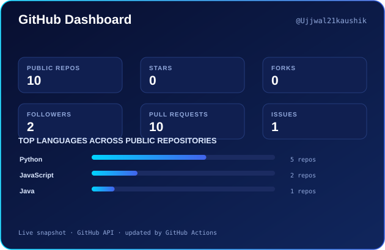

<!--
  GitHub Profile README for Ujjwal21kaushik
  Repository name must be exactly: Ujjwal21kaushik
  Animations in /assets are self-hosted SVGs, so they never depend on third-party servers.
  GitHub and LeetCode cards are generated by .github/workflows/leetcode.yml.
  Both cards are self-hosted SVGs in /assets and are refreshed by GitHub Actions.
-->

  

  
  
  
  
  

<!-- 

  

 -->

---

## 🚀 At a Glance

<table>
<tr>
<td width="50%" valign="top">

### 👨‍💻 Who I am
Computer Science engineering student who enjoys **building backend systems**, **solving DSA problems** and shipping practical projects.

**I learn by building, debugging and improving, one step at a time.**

</td>
<td width="50%" valign="top">

### 🎯 What I'm focused on
| | |
|---|---|
| 🐍 | **Python backend** and REST APIs |
| ☕ | **DSA in Java** |
| 🔐 | Auth, databases, caching, API security |
| ⚛️ | React, Tailwind CSS, JavaScript |

</td>
</tr>
</table>

---

## ⚡ Tech Stack

<table>
<tr>
<td align="center" width="22%"><b>💻 Languages</b></td>
<td>
  
</td>
</tr>
<tr>
<td align="center"><b>🧩 Backend &amp; Frameworks</b></td>
<td>
  
</td>
</tr>
<tr>
<td align="center"><b>🗄️ Databases</b></td>
<td>
  
</td>
</tr>
<tr>
<td align="center"><b>🛠️ Tools &amp; Deploy</b></td>
<td>
  
</td>
</tr>
</table>

---

## 🔄 How I Think About Backends

  

  Every request is validated, authenticated, served from cache when possible, and only then sent to the database.

---

## 🚀 Featured Projects

  <i>A selection of projects where I turn concepts into working software.</i>

<table>
<tr>
<td width="50%" valign="top">

<h3>🔐 CampusPramaan</h3>

<b>Multi-Layer Campus Attendance System</b>

A Django-based attendance prototype that combines face recognition with location-based verification for on-campus attendance.

  
  
  
  

<a href="https://github.com/Ujjwal21kaushik/CampusPramaan"><b>Explore repository →</b></a>

</td>
<td width="50%" valign="top">

<h3>📦 StockDrishti</h3>

<b>Inventory Management System</b>

A Python project focused on inventory management and stock operations.

  

<a href="https://github.com/Ujjwal21kaushik/StockDrishti"><b>Explore repository →</b></a>

</td>
</tr>
<tr>
<td width="50%" valign="top">

<h3>🌐 CDN Project</h3>

<b>Location-Aware Content Delivery Network</b>

A mini CDN exploring gateway-based routing and location-aware edge-server selection.

  
  
  

<a href="https://github.com/Ujjwal21kaushik/cdn_project"><b>Explore repository →</b></a>

</td>
<td width="50%" valign="top">

<!-- <h3>🏢 Business Listing Platform</h3>

<b>Coming soon to GitHub</b>

A Justdial-style business discovery platform. The public repository link will be added once the project is published.

  

<i>Project preview slot · link to be added later</i>
 -->

</td>
</tr>
</table>

## 🧠 LeetCode & Problem Solving

  

  

  Problem-solving practice with a focus on Data Structures and Algorithms in Java.

---

## 📈 GitHub Dashboard

  

---

## 🤝 Let's Connect

  <i>“Small progress every day adds up to big results.”</i>

  
  
  

  

