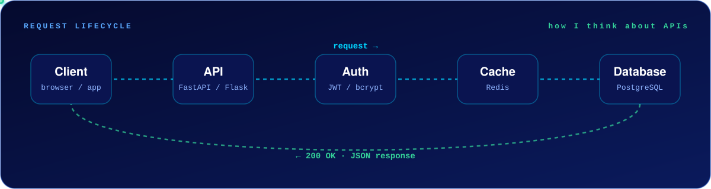
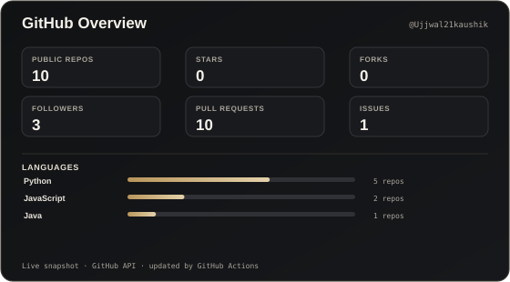

<!--
  GitHub Profile README for Ujjwal21kaushik
  Repository name: Ujjwal21kaushik
  Uses the existing self-hosted SVG assets and GitHub Actions workflow.
-->

  

  
  
  
  
   
  

 

  

---

## 01 / About Me

<table>
  <tr>
    <td width="58%" valign="top">
      Computer Science engineering student who enjoys **building backend systems**, **solving DSA problems** and shipping practical projects.

      I learn by building, debugging and improving, one step at a time.
    </td>
    <td width="42%" valign="top">
      **Currently focused on**
      - Python backend development and REST APIs
      - Data Structures & Algorithms in Java
      - Authentication, databases, caching and API security
      - React, Tailwind CSS and JavaScript
    </td>
  </tr>
</table>

  
  Understanding how a request moves through the backend — from the client to the API, authentication, cache and database.

---

## 02 / Featured Work

<i>A selection of projects where I turn concepts into working software.</i>

<table>
  <tr>
    <td width="50%" valign="top">
      <h3>CampusPramaan</h3>
      <b>Multi-Layer Campus Attendance System</b>
      
A Django-based attendance prototype that combines face recognition with location-based verification for on-campus attendance.

      

        
        
        
        
      

      <a href="https://github.com/Ujjwal21kaushik/CampusPramaan"><b>Explore repository →</b></a>
    </td>
    <td width="50%" valign="top">
      <h3>StockDrishti</h3>
      <b>Inventory Management System</b>
      
A Python project focused on inventory management and stock operations.

      

      <a href="https://github.com/Ujjwal21kaushik/StockDrishti"><b>Explore repository →</b></a>
    </td>
  </tr>
  <tr>
    <td width="50%" valign="top">
      <h3>CDN Project</h3>
      <b>Location-Aware Content Delivery Network</b>
      
A mini CDN exploring gateway-based routing and location-aware edge-server selection.

      

        
        
        
      

      <a href="https://github.com/Ujjwal21kaushik/cdn_project"><b>Explore repository →</b></a>
    </td>
    <td width="50%" valign="top">
      <h3>Vypaar Setu</h3>
      <b>Full-Stack Business Listing &amp; Discovery Platform</b>
      
A JustDial-style platform connecting customers with local businesses through search, category browsing, business profiles, ratings and reviews, bookmarks, and customer enquiries. Includes business-owner dashboards and admin workflows for listing verification, category management and lead moderation.

      

        
        
        
        
        
        
      

      <b>Key Areas:</b> Business Discovery · Authentication · Listing Management · Reviews · Bookmarks · Admin Dashboard · Lead Management
        
      <a href="https://github.com/Ujjwal21kaushik/Vypaar-Setu"><b>Explore repository →</b></a>
    </td>
  </tr>
</table>

---

## 03 / Toolbox

<table>
  <tr>
    <td align="center" width="22%"><b>Languages</b></td>
    <td></td>
  </tr>
  <tr>
    <td align="center"><b>Backend &amp; Frameworks</b></td>
    <td></td>
  </tr>
  <tr>
    <td align="center"><b>Databases</b></td>
    <td></td>
  </tr>
  <tr>
    <td align="center"><b>Tools &amp; Deploy</b></td>
    <td></td>
  </tr>
</table>

---

## 04 / Problem Solving

  
   
  <a href="https://leetcode.com/u/ueMXf7R1D6/"><b>Visit LeetCode profile →</b></a>

---

## 05 / GitHub Activity
done

  

---

## 06 / Let's Connect

<i>“Small progress every day adds up to big results.”</i>

  
  
  

  

